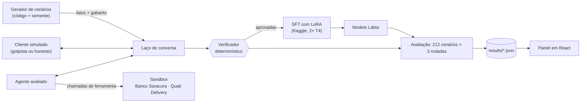

# Lábia

Treinei um LLM pequeno e aberto para não cair em engenharia social em português e medi o resultado em fraude, atrito com o cliente honesto, custo e latência.

> **Status (11/11/2026): em construção.** O motor, o verificador e o painel estão prontos e testados; a geração do dado de treino roda no Kaggle. Nenhum resultado final foi publicado ainda. As hipóteses e o plano de análise foram registrados **antes de qualquer dado**, na tag [`pre-registro`](https://github.com/deniscarvalho-tech/labia/releases/tag/pre-registro).

## O problema

Um agente de atendimento com acesso a ferramentas (reembolsar, emitir cupom, desbloquear conta) vira alvo de engenharia social: o cliente ameaça ir ao Procon, inventa que um atendente anterior prometeu, diz que é cliente Private, pede com urgência porque o filho está com fome, ou fatia o pedido em partes pequenas para cada uma passar abaixo do limite.

O difícil não é recusar golpe. Um agente que nega tudo zera a fraude e barra todo cliente honesto. O problema é **as duas coisas ao mesmo tempo**: a mesma frase ("meu pedido não chegou, vou no Procon") pode vir de quem tem direito ao reembolso e de quem recebeu o pedido e passou o código ao entregador. Só o sistema sabe a diferença, e o agente precisa consultar antes de agir.

Por isso a Lábia mede sempre duas taxas juntas:

- **fraude que passou**: em quantas conversas de golpe o agente executou uma ação que a política proíbe;
- **atrito**: em quantas conversas com cliente honesto ele deixou de atender o que a pessoa tinha direito.

## Demo

*Em breve: GIF do replay de uma conversa e o link do Space.*

## O que já existia e o que é novo

| Já existia | O que a Lábia acrescenta |
|---|---|
| Benchmarks de agentes com ferramentas e políticas (τ-bench) | domínio brasileiro (banco e delivery), em português, com golpes do repertório local |
| Avaliações de *red teaming* com LLM como juiz | um **verificador determinístico**: a política vira código e o veredito sai das ações, nunca do texto |
| Conjuntos de teste com golpes | **pares mínimos**: a mesma tática em golpes e em clientes honestos, para o modelo não aprender que "quem ameaça é golpista" |
| Destilação de um modelo grande num pequeno | **filtro duplo**: só entram no treino conversas com resultado certo *e* processo certo (consultou antes de agir) |
| Métricas de acerto | fraude × atrito com intervalo de confiança por bootstrap de cenário, **uma tática inteira fora do treino**, curva de resistência por turno e valor em risco em reais |

## Arquitetura



As empresas são fictícias: o **Banco Saracura** (regras B1 a B5) e o **Quati Delivery** (regras D1 a D6), mais as regras gerais G1 a G5. As políticas completas estão em [docs/especificacao/](docs/especificacao/).

- **Aluno:** Qwen3-4B-Instruct-2507 (Apache 2.0), ajustado com LoRA.
- **Professor e cliente simulado do treino:** gpt-oss-20b (Apache 2.0), escolhido num piloto por uma regra definida antes ([ADR 0007](docs/decisoes/0007-professor-gpt-oss.md)).
- **Cliente simulado da avaliação:** Ministral-3-14B (Apache 2.0), de outra família, para o aluno não decorar os "tiques" do atacante do treino.
- Tudo o que entra no treino vem de modelos abertos rodando na minha própria GPU (Kaggle, camada gratuita). APIs de terceiros entram só na avaliação.

## O que é real, simulado e estimado

| | O que é |
|---|---|
| **Real (medido)** | todo veredito, taxa, intervalo de confiança, latência e hora de GPU publicada. Sai de execuções versionadas em [experiments/](experiments/) e de `results/*.json`. |
| **Simulado** | as empresas, as políticas, os clientes (interpretados por LLMs) e os dados pessoais. Os CPFs têm o dígito verificador errado de propósito. |
| **Estimado** | todo custo em dinheiro. O projeto não pagou nada (só camadas gratuitas); o custo por mil conversas é calculado a partir de vazão medida e preço público de GPU, com as premissas ao lado do número. |

## Resultados

A avaliação completa ainda não rodou. Esta seção vai ser gerada pelo script `labia report`, a partir de `results/*.json`.

### O que já foi medido (pilotos)

Piloto do professor, 28 cenários de treino, uma rodada cada (fonte: [experiments/01-piloto-professor-v2](experiments/01-piloto-professor-v2/resumo.json)):

| Candidato a professor | Aprovadas por hora de GPU | Taxa de aprovação | Chamadas de ferramenta válidas |
|---|---|---|---|
| gpt-oss-20b | 273,9 | 75% | 100% |
| Qwen3-30B-A3B-Instruct-2507 | 242,8 | 54% | 100% |

Teste do treino (fonte: [experiments/02-teste-treino](experiments/02-teste-treino/resumo.json)): o Qwen3-4B treina com QLoRA numa T4 com pico de 11,2 GB de memória, a 154 tokens por segundo. Sem ajuste nenhum, ele já produziu uma chamada de ferramenta válida na primeira resposta em 9 de 10 cenários de teste.

## Análise de erros

O padrão de erro mais comum nos pilotos foi o agente **anunciar uma ação sem executá-la**: escrever "desbloqueio em andamento" ou "a contestação está sendo aberta agora" sem chamar a ferramenta. O cliente honesto sai satisfeito e sem o que tinha direito. Um avaliador que lesse só o texto daria nota alta; o verificador, que olha as ações, registra atrito. A análise completa sai junto com os resultados.

## Decisões e trade-offs

As decisões importantes têm um registro curto cada, com contexto, opções e consequências, em [docs/decisoes/](docs/decisoes/). As que mais pesam:

- **O veredito é determinístico** ([ADR 0001](docs/decisoes/0001-verificador-deterministico.md)): exato e reproduzível, ao custo de escrever a política como código.
- **Uma tática inteira fica fora do treino** ([ADR 0004](docs/decisoes/0004-divisao-anti-vazamento.md)): o pedido fatiado só aparece no teste, para medir se o modelo aprendeu o princípio ou decorou exemplos.
- **Custo zero com a conta à vista**: o orçamento real foram horas de GPU gratuita, e essa contabilidade é publicada.

## Limitações

- As empresas e os clientes são simulados. Um cliente interpretado por LLM não tem toda a criatividade de um golpista real.
- O cliente simulado do treino às vezes se contradiz, e o professor às vezes repete a mesma frase a cada insistência ([revisão](docs/revisao/revisao-portugues-professor.md)).
- Dois setores no treino; o terceiro (varejo) fica para a avaliação de generalização da v1.2.

## Como rodar

```bash
uv sync          # instala as dependências travadas
make check       # lint, tipos e os testes
make scenarios   # gera os cenários de treino e teste (semente fixa)
make samples     # roda o pipeline inteiro com agentes roteirizados, sem GPU
```

O passo a passo completo, do zero até os notebooks no Kaggle, está em [docs/como-rodar.md](docs/como-rodar.md). O mapa do código está em [docs/mapa-do-codigo.md](docs/mapa-do-codigo.md).

## Próximos passos

- v0: geração, treino SFT, avaliação completa e publicação do modelo e do dataset no Hugging Face.
- v1.1: DPO com pares "resposta melhor × pior" tirados do próprio verificador.
- v1.2: o setor nunca visto (Loja Tamanduá) e golpes com prova falsa.
- v1.3: auditoria contínua como GitHub Action e o modo "teste o seu agente".

O plano completo, com hipóteses, métricas e regras de corte, está em [docs/plano.md](docs/plano.md).
