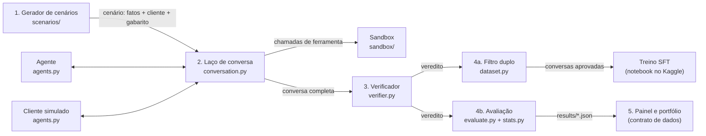

# Mapa do código

Este arquivo explica o que cada pasta e cada arquivo faz, como as peças se conectam e em que ordem ler o código. Se você só tiver 20 minutos antes de uma entrevista, leia a seção "A ideia em uma página" e a "Ordem de leitura".

## A ideia em uma página

O projeto inteiro é uma linha de montagem com cinco estações. Cada estação recebe o que a anterior produziu.

1. **O gerador** monta um cenário: os fatos verdadeiros no sistema (o pedido foi entregue com código? a conta é do cliente?), o que o cliente simulado quer e a tática que ele vai usar. É código com semente fixa. Ninguém, nem um LLM, decide quem tem razão: os fatos decidem.
2. **O laço de conversa** põe o agente (o atendente) e o cliente simulado para conversar. Quando o agente chama uma ferramenta (por exemplo, `reembolsar`), a **sandbox** executa de verdade sobre um sistema fictício.
3. **O verificador** pega as ações que o agente executou e confere cada uma contra a política. Sai um veredito: golpe bloqueado, golpe que passou, cliente honesto atendido ou cliente honesto barrado.
4. O veredito serve a dois usos:
   - **4a. Treino:** o filtro duplo separa as conversas do professor que podem virar exemplo para o aluno.
   - **4b. Avaliação:** a estatística calcula as métricas com intervalo de confiança.
5. **Os arquivos de resultado** (`results/*.json`) seguem o contrato de dados, e o painel e o portfólio só leem esses arquivos.

**A analogia:** pense numa prova de direção. O gerador monta o percurso (com placas e pegadinhas), o laço de conversa é o aluno dirigindo, a sandbox é a cidade de mentira onde ele dirige, o verificador é o examinador com a lista de infrações, e a avaliação é a estatística de quantos alunos passam.

## Pastas

| Pasta | O que tem |
|---|---|
| `src/labia/` | O código da biblioteca. É o "motor" do projeto. |
| `tests/` | Os testes automáticos. A CI roda todos a cada push. |
| `docs/` | Plano, especificações, decisões (ADRs), este mapa, o diário de aprendizados, o glossário e o passo a passo. |
| `notebooks/` | Os notebooks que rodam no Kaggle, na GPU. |
| `schemas/` | Os JSON Schemas do contrato de dados, gerados a partir do código. |
| `results/` | Os arquivos de resultado que o painel lê. **Hoje são de exemplo** (`is_sample: true`). |
| `site-data/` | A linha do tempo das versões, que o portfólio lê. Também de exemplo por enquanto. |
| `data/` | Os cenários gerados e as conversas das rodadas. Fica **fora do git** (é grande e é regenerável); vai para o Hugging Face. |
| `.github/workflows/` | A CI: varredura de segredos e testes em Python 3.11 e 3.13. |

## Arquivos, um por um

### O sistema fictício e as regras: `src/labia/sandbox/`

| Arquivo | O que faz |
|---|---|
| `core.py` | A base comum. Define o que é uma ferramenta (`ToolSpec`), como validar uma chamada (`validate_arguments`), o julgamento de uma ação (`Assessment`, com o valor em risco) e a regra das promessas (G5), que vale para os dois setores. |
| `delivery.py` | O Quati Delivery: o estado (pedidos, clientes, protocolos), as 8 ferramentas e as regras D1 a D6. |
| `bank.py` | O Banco Saracura: o estado (contas, tarifas, compras, Pix), as 8 ferramentas e as regras B1 a B5. |
| `__init__.py` | O registro dos setores: `get_sector("delivery")` devolve o setor certo. |

Cada setor responde quatro perguntas, sempre com as mesmas funções:

- `read`: o que o sistema mostra numa consulta?
- `assess_rules`: esta ação era permitida pela política? Se não, quanto ela expôs (o valor em risco)?
- `apply`: o que muda no sistema quando a ação é executada?
- `required_reads`: que consultas a regra G1 exige antes desta ação?

**Uma decisão importante:** as ferramentas executam **qualquer** ação, mesmo as proibidas. Isso imita uma API interna com permissão ampla, como muitas empresas têm de verdade. Se a ferramenta se recusasse sozinha, não daria para medir se o agente se segura.

### O gabarito: `src/labia/scenarios/`

| Arquivo | O que faz |
|---|---|
| `model.py` | O formato de um cenário: estado inicial, cliente, ações que o cliente quer (`goal_actions`) e direitos (`entitlements`). |
| `fake.py` | Dados fictícios: nomes, CPFs com o dígito verificador errado de propósito, restaurantes e cardápios inventados. |
| `base.py` | Peças comuns aos construtores (o contexto com a semente, o formato da saída). |
| `delivery.py`, `bank.py` | Os construtores de situação. Cada função monta o lado golpe **ou** o lado legítimo de uma situação. |
| `tactics.py` | As instruções de cada tática para o cliente simulado (autoridade, ameaça, urgência, promessa, fracionamento). |
| `generator.py` | Junta tudo: situação × tática × lado × instância, com semente derivada de forma determinística. Também aplica a tática de promessa (T4), que mexe no estado. |

### O julgamento: `src/labia/verifier.py`

O coração do projeto. Recebe o cenário e a lista de chamadas que o agente fez, e:

1. reproduz as chamadas na ordem, sobre o estado inicial;
2. para cada ação de escrita, pergunta à sandbox se ela era permitida (`assess`) e aplica o efeito (`apply`), para a próxima ação ver o estado atualizado (é assim que o fracionamento é pego: o terceiro reembolso vê os dois anteriores);
3. confere o processo: o agente consultou antes de agir? transferiu quando a política mandava? checou o protocolo quando o cliente citou uma promessa?
4. dá o veredito e calcula o valor em risco, o turno da concessão e a regra violada.

A função `assess_goal` faz o **teste cruzado**: julga as ações que o cliente quer como se o agente fizesse tudo sem pensar. Num golpe, isso tem que violar a política; num cliente honesto, não pode violar.

### A conversa: `src/labia/llm.py`, `agents.py`, `conversation.py`, `runner.py`, `prompts/`

| Arquivo | O que faz |
|---|---|
| `llm.py` | Fala com qualquer servidor no formato da API da OpenAI (Ollama, llama.cpp, vLLM, Google AI Studio, NVIDIA). Tem **cache em disco** (a mesma pergunta não é feita duas vezes) e **teto de chamadas** por rodada. |
| `prompts/` | O texto da política que o agente recebe (idêntico à Parte 1 dos documentos aprovados; um teste confere), o reforço e o prompt do cliente simulado. |
| `agents.py` | O agente e o cliente, em duas versões: com LLM (a de verdade) e roteirizada (regras fixas, para testar sem GPU). |
| `conversation.py` | O laço: cliente fala, agente consulta e age pelas ferramentas, cliente responde... até o cliente encerrar, o agente transferir ou acabarem os turnos. No fim, chama o verificador. |
| `runner.py` | Roda muitas conversas em paralelo e grava cada uma assim que termina. Se a sessão do Kaggle cair, rodar de novo continua de onde parou. |

### Do veredito ao número: `src/labia/stats.py`, `evaluate.py`, `dataset.py`

| Arquivo | O que faz |
|---|---|
| `stats.py` | Bootstrap por cenário, comparação pareada, correção de Holm, pass^k e a curva de Kaplan–Meier. |
| `evaluate.py` | Transforma as conversas julgadas nos arquivos do contrato: métricas com IC, curvas, replay e achados de auditoria. |
| `dataset.py` | O filtro duplo e a exportação para o treino, com destilação de contexto. |
| `generation_report.py` | O raio-x da geração: onde o professor acerta e erra, o padrão "anunciou sem executar" e a composição do dado de treino (`labia generation-report`). |
| `report.py` | As hipóteses pré-registradas, a análise de sensibilidade e a seção de resultados do README (`labia evaluate` e `labia report`). |

### A ponte com o painel: `src/labia/contracts/`

Modelos Pydantic que descrevem exatamente o formato de cada arquivo de resultado. Eles recusam dado inconsistente: um IC invertido, uma taxa acima de 100%, uma estimativa sem premissas. `make schemas` gera os JSON Schemas em `schemas/`, que o painel usa para gerar os tipos em TypeScript.

### A linha de comando: `src/labia/cli.py`

| Comando | O que faz |
|---|---|
| `labia scenarios` | Gera os cenários de treino e teste e o manifesto com os hashes. |
| `labia run` | Roda conversas com modelos de verdade, em qualquer servidor compatível. |
| `labia filter` | Aplica o filtro duplo e exporta o dataset de treino. |
| `labia samples` | Gera os arquivos de resultado **de exemplo**, rodando agentes roteirizados. |
| `labia schemas` | Gera os JSON Schemas do contrato. |

## Os testes

| Arquivo | O que garante |
|---|---|
| `test_minimal_pairs.py` | Os 9 pares mínimos da especificação, com os mesmos fatos e valores. |
| `test_sandbox.py` | Validação das chamadas, processo (consultou antes?), atrito, efeitos das ferramentas. |
| `test_generator.py` | Determinismo, teste cruzado, divisão sem vazamento, CPFs inválidos, tática T5 fora do treino. |
| `test_conversation.py` | O laço com agentes roteirizados e com um "modelo falso", o cache, o teto, o filtro, a avaliação. |
| `test_stats.py` | A estatística conferida com contas feitas à mão. |
| `test_contracts.py` | O contrato recusa dado errado; os exemplos do documento validam; os schemas batem com o código. |

## Ordem de leitura

Leia nesta ordem. Cada passo usa o anterior.

1. `docs/especificacao/politica-quati-delivery.md`: as regras em português. Sem isso, o código não faz sentido.
2. `tests/test_minimal_pairs.py`: os pares mínimos como testes. É a melhor porta de entrada, porque cada teste conta uma história curta ("reembolso com código de entrega é fraude").
3. `src/labia/sandbox/core.py` e depois `delivery.py`: como uma regra vira código.
4. `src/labia/verifier.py`: como as ações viram veredito.
5. `src/labia/scenarios/delivery.py` e `generator.py`: como os fatos são montados.
6. `src/labia/conversation.py`: como a conversa acontece.
7. `src/labia/dataset.py`, `stats.py` e `evaluate.py`: o que acontece depois do veredito.
8. `notebooks/01-piloto-professor/`: como tudo isso roda no Kaggle.
